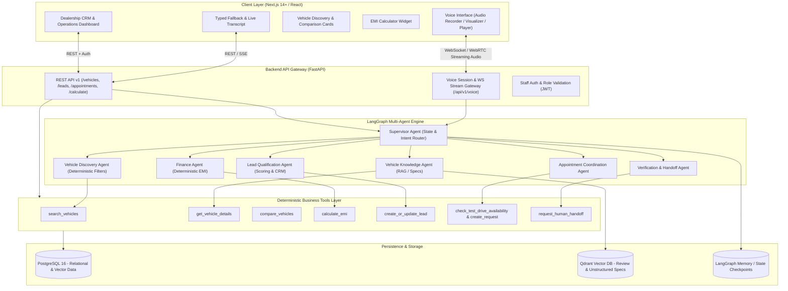

# Agent Architecture Specification
## Voice-First Multi-Agent AI Platform for Automotive Sales and Customer Experience

### 1. High-Level System Architecture

---

### 2. Voice Architecture & Security Boundaries

1. **Zero Privileged Keys in Browser**:
   - The browser connects to the FastAPI backend via an authenticated WebSocket session (`/api/v1/voice/session` and `/api/v1/voice/stream`).
   - The backend holds the `GEMINI_API_KEY` and manages the real-time audio session (or proxies the Gemini Live bidi-stream / STT+LLM+TTS pipeline).
2. **Audio Streaming Pipeline**:
   - Input: Browser captures PCM 16kHz audio chunks via Web Audio API AudioWorklet.
   - Processing: Streaming audio input received by backend -> speech transcription / multimodal stream -> LangGraph agent execution.
   - Output: Audio stream generated -> streamed back via WebSocket to client AudioContext for low-latency playback.
   - Interruption handling: Client-side voice activity or interruption signal cancels playback queue and sends cancel event to backend session.
3. **Multilingual Support (English & Malayalam)**:
   - Real-time provider handles English and Malayalam speech input.
   - Local fallback pipeline: Whisper / Vosk STT -> Gemini text reasoning -> Kokoro / EdgeTTS / Google Cloud TTS.

---

### 3. Multi-Agent Workflow Specification

| Agent | Responsibility | Permitted Tools | Guardrails |
| :--- | :--- | :--- | :--- |
| **Supervisor** | Intent triage, state persistence, turn delegation, synthesis | None directly | Cannot execute DB queries; bounds retries to max 3 |
| **Vehicle Discovery** | Parse hard/soft constraints, retrieve matching inventory | `search_vehicles`, `get_vehicle_details` | Must apply hard price/fuel/transmission constraints strictly in SQL |
| **Vehicle Knowledge** | Specs, brochures, safety ratings, feature queries | `get_vehicle_details`, `compare_vehicles` | Explicitly states "Unknown/Unverified" for missing attributes |
| **Finance** | Loan parameters, indicative monthly installments | `calculate_emi` | Cannot invent interest rates; must tag results as indicative |
| **Lead Qualification** | Extract customer profile, timeline, interest level | `create_or_update_lead`, `get_lead_details` | Requires explicit consent before recording PII |
| **Appointment Coordination** | Slot check, test drive bookings, staff routing | `check_test_drive_availability`, `create_test_drive_request` | Prevents duplicate bookings; only backend can confirm status |
| **Verification & Handoff** | Fact verification, conflict detection, staff escalation | `request_human_handoff`, `create_follow_up_task` | Triggers whenever user requests human or model detects low confidence |

---

### 4. Data Model & Storage

- **PostgreSQL**:
  - `dealerships`
  - `staff_users`
  - `vehicles`, `variants`, `specs`, `price_history`
  - `customers`, `customer_preferences`
  - `conversations`, `messages`
  - `leads`, `lead_vehicles`
  - `appointments`, `follow_up_tasks`
  - `agent_runs`, `agent_events`, `audit_logs`
- **Qdrant**:
  - Unstructured customer vehicle reviews, expert road test summaries, brochure text embeddings for semantic hybrid retrieval.
